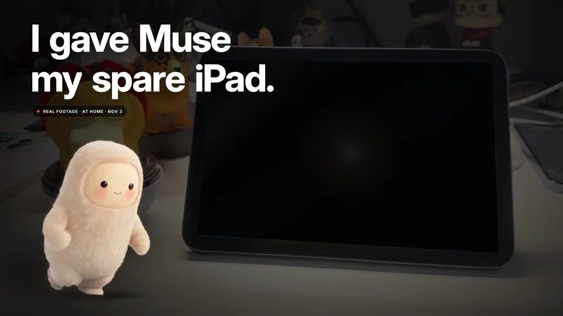
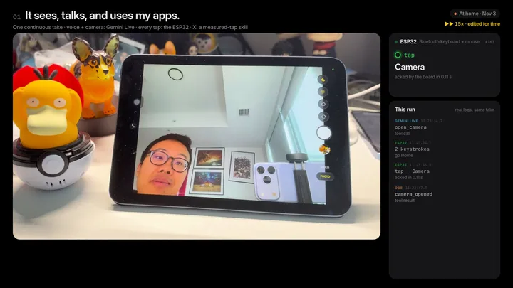
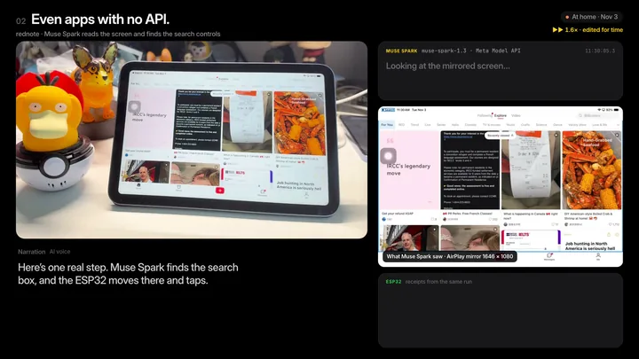
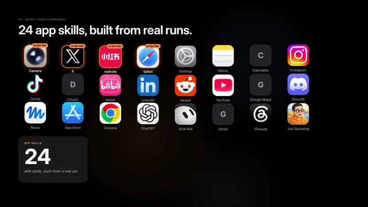
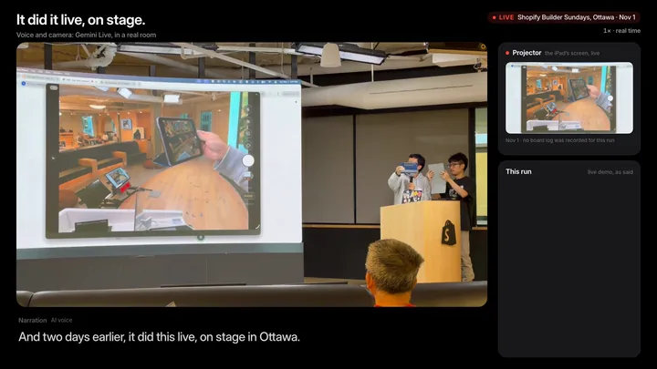

<div align="center">
  
  <h1>Ode</h1>
  <p><strong>Give Muse a body on the iPad you already own.</strong></p>
  <p>
    <a href="LICENSE"></a>
    <a href="https://github.com/hubeiqiao/ode-muse-body/actions/workflows/ci.yml"></a>
    <a href="#meta-ai-usage"></a>
    <a href="docs/JUDGES.md"></a>
    <a href="docs/SETUP.md"></a>
    <a href="docs/HARDWARE.md"></a>
    <a href="https://youtu.be/0wcoqi5CVuQ"></a>
    <a href="https://x.com/hubeiqiao"></a>
  </p>
  <p>
    <a href="#demo">Demo</a> · <a href="#how-it-works">How it works</a> · <a href="#quick-start">Quick start</a> · <a href="docs/JUDGES.md">Judges</a> · <a href="#safety-and-limits">Safety</a> · <a href="#credits-and-license">Credits</a>
  </p>
</div>

## Demo

<p align="center">
  <a href="https://youtu.be/0wcoqi5CVuQ"></a>
</p>
<p align="center">
  <a href="https://youtu.be/0wcoqi5CVuQ"></a>
</p>

https://github.com/user-attachments/assets/883dbbaa-a3f9-4b56-9db3-3a5ea700166f


<p align="center"><a href="https://youtu.be/0wcoqi5CVuQ"><strong>Watch the full 2:58 film ↗</strong></a> · <a href="docs/DEMO.md">Chapters &amp; editing disclosure</a> · <a href="docs/JUDGES.md">Two-minute judge guide</a></p>

Ode sees the screen, talks with you, and taps and types in real iPad apps. **Muse Spark plans app work; an ESP32 supplies Bluetooth hands; a Mac coordinates the loop.** Gemini Live handles voice and camera conversation. Muse runs in the cloud.

Built by **Joe Hu** ([@hubeiqiao](https://x.com/hubeiqiao)) for the **Meta Global AI Developer Hackathon**. Based on [ESP32 iPhone Agent](https://github.com/onehumanbeing/esp32-iphone-agent) by Henry Yuan.

## Why

- **An idle device becomes an AI body.** Reuse a spare iPad for an assistant you can see and talk to.
- **Real apps, without per-app APIs.** Work through the installed app’s screen and ordinary Bluetooth input.
- **Muse Spark plans. ESP32 acts.** Connect model decisions to physical input and inspect the changed screen.

For builders and creators who already own a Mac and iPad, the intended everyday job is attended app research, checked findings and drafts for review. Repeat-run reliability and time saved are next to measure.

## What it can do

<table>
  <tr>
    <td width="50%" align="center">
      <a href="https://youtu.be/0wcoqi5CVuQ?t=29"></a><br>
      <strong>Camera → photo → X</strong><br>One source take, measured taps, fresh owner confirmation; this silent excerpt is accelerated 4×.
    </td>
    <td width="50%" align="center">
      <a href="https://youtu.be/0wcoqi5CVuQ?t=89"></a><br>
      <strong>A Muse decision becomes a real tap</strong><br>rednote search-entry grounding beside the recorded HID activity.
    </td>
  </tr>
  <tr>
    <td align="center">
      <a href="https://youtu.be/0wcoqi5CVuQ?t=127"></a><br>
      <strong>Goals, Feed &amp; Library</strong><br>Bounded research, checked sources and owner-controlled memory; saved UI state, excerpt at 2×.
    </td>
    <td align="center">
      <a href="https://youtu.be/0wcoqi5CVuQ?t=144"></a><br>
      <strong>Live in Ottawa</strong><br>Room conversation and an Amazon search at Shopify Builder Sundays, November 1; excerpt at 2×.
    </td>
  </tr>
</table>

The film compresses waits and marks speed changes. The opening leap is composited; enlarged Mac chat is redrawn. Camera/X uses a calibrated skill; the rednote step is the clearest filmed Muse screen decision. [Full evidence boundaries](docs/DEMO.md).

## How it works


1. **See.** AirPlay mirrors the iPad’s native-aspect screen to the Mac.
2. **Plan.** Muse Spark interprets the task and screen; known skills can take bounded fast paths.
3. **Check.** Local OCR, calibration and configured visual checks ground proposed input.
4. **Act.** The Mac sends commands over local Wi-Fi/TCP; the ESP32 supplies Bluetooth keyboard/mouse input.
5. **Observe.** Read the changed screen, keep task receipts, and stop on uncertainty rather than replay input.

[Architecture & source map](docs/ARCHITECTURE.md) · [Model routing](docs/ARCHITECTURE.md#model-routing)

## Proof it works

At **01:30.17**, Muse Spark locates rednote’s public search entry. The selected real-run excerpt connects its decision to the board:

```text
muse-spark-1.3 → search-entry box [0.808, 0.035, 0.985, 0.078]
model time 4.287 s · confidence 0.95
ESP32 #362 home → #363–366 move → #367 click
click write → ACK: 0.132 s · accepted=true
```

An ACK means board acceptance; the changed screen supplies visual evidence. This is one selected step, not an average-latency or app-coverage benchmark. [Full sanitized excerpt](docs/DEMO.md#sanitized-real-run-excerpt).

- **Published output:** [the existing X post from the demo](https://x.com/hubeiqiao/status/2117654510482960846). The automated check returned uncertainty and did not resend; the film shows the result card.
- **Live demonstration:** **02:24 onward**, Ottawa stage footage; Amazon AirPods search at **02:33.47**.
- **Inspectable engineering:** [judge guide](docs/JUDGES.md), [source-linked regressions and execution records](docs/TESTING.md). Offline verification is separate from device acceptance.

## Quick start

**Two routes:** inspect [offline verification](docs/TESTING.md) with no device or API credentials, or follow the attended hardware setup below. Python **3.12** and Node **22+** are the verification targets. No jailbreak or Xcode IDE is required; Mac command-line developer tools are needed for the receiver/OCR.

<details>
<summary><strong>1. Install the coordinator</strong></summary>

```sh
git clone https://github.com/hubeiqiao/ode-muse-body.git
cd ode-muse-body
python3.12 -m venv .venv
. .venv/bin/activate
python -m pip install -e './server[dev,mcp]'
npm ci --prefix tools/twitter-text-validator
cp server/.env.example server/.env
```

Fill `META_API_KEY`, `TYPESAFE_API_KEY` and `GEMINI_LIVE_API_KEY` locally. Keep the filled file untracked. The rebuilt companion is included. [Full setup](docs/SETUP.md).

</details>

<details>
<summary><strong>2. Prepare the board and AirPlay</strong></summary>

Follow [Hardware](docs/HARDWARE.md): identify the ESP32-C3, explicitly select its serial port, back up and verify the backup before flashing. Pair **Ode iPad HID** with the iPad and [install UxPlay separately](docs/SETUP.md#airplay-receiver). USB powers/flashes the board; the iPad receives input over Bluetooth. No GPIO wiring or iPad app installation is needed.

</details>

<details>
<summary><strong>3. Start Ode on the Mac</strong></summary>

The geometry below is an iPad mini example; choose your own display size.

```sh
export AGENT_ENGINE=meta_hybrid META_MODEL=muse-spark-1.3
export DEVICE_MODE=ipad AI_NAME=Ode AIRPLAY_NAME='Ode iPad'
export HOST=127.0.0.1 PORT=8890 DEVICE_PORT=7300 IDLE_NUDGE=0
export HIDAGENT_DATA="$PWD/runtime/ipad"
export UXPLAY="$PWD/scripts/uxplay-ipad.sh"
export UXPLAY_DISPLAY_SIZE=2266x1488 MIRROR_FRAME_HEIGHT=1080
./scripts/run-ode.sh
```

</details>

<details>
<summary><strong>4. Mirror, calibrate, try “Open Settings”</strong></summary>

Mirror to **Ode iPad** in landscape full-screen mode. Open the [companion](http://127.0.0.1:8890/companion) and [calibration UI](http://127.0.0.1:8890/). Confirm live frames, stable board connection and calibration before an attended “Open Settings.” Follow the [acceptance ladder](docs/SETUP.md#first-run-acceptance-ladder).

Goals need `APP_MISSIONS=1`; Meta Goal/draft roles use `META_MISSION_WRITER=1` and `META_DRAFT_WRITER=1`. Exploration needs `EXPLORATION_PUBLIC_BROWSER=1`. Enable attended sessions only after setup. Camera/photo fast paths need your own masked templates and local OCR; personal captures and calibration are excluded from this checkout. Saved-state companion views start empty on a fresh clone.

</details>

### Hardware and costs

| Item | Requirement / cost |
| --- | --- |
| ESP32-C3 development board | **Approximately $5, board only**; supplier-dependent |
| Mac | Required coordinator, AirPlay receiver and local OCR; additional cost |
| iPad | Owner-controlled device with AirPlay and Bluetooth HID; additional cost |
| USB data cable + trusted network | Board power/flashing and local connectivity; additional cost |
| Cloud APIs | Meta Muse Spark, Jev and Gemini Live access; usage costs vary |

[Board preparation, pairing & calibration](docs/HARDWARE.md)

## Meta AI usage

| Layer | Model / role |
| --- | --- |
| **Device reasoning and writing** | **Meta `muse-spark-1.3`** through Meta Model API: planner/actor, Goal planner, source/draft writer and bounded fallback visual judge |
| Visual proposal checks | Jev `jev-latest` is the primary visual judge; the filmed landscape locate explicitly routes to Muse Spark |
| Voice and camera conversation | Gemini Live `gemini-3.8-live` in the documented setup; delegates device work to the coordinator |
| Local execution | Skills, OCR, calibrated taps and selected Hermes memory-store components on the Mac |

Muse runs in the cloud, not on the iPad or board. Known skills need no Muse call for every click. Wonder and local Glimmer are optional code paths; no demo use is claimed. [Exact routing and flags](docs/ARCHITECTURE.md#model-routing).

## Safety and limits

- **Stay present.** Guarded photo sending requires fresh confirmation. The operator checks account, photo and exact caption; prompts are not a universal authorization boundary. Keep purchases, credentials and sensitive settings human-operated.
- **Uncertain delivery stops replay.** Inspect the actual screen; a closed composer alone does not prove publication. Stop tracks controller release, which can remain pending if the board disconnects.
- **Cloud processing is explicit.** Task frames/instructions go to configured Meta/Jev providers. Explicit voice sessions send audio and live vision to Gemini. Keep private notifications out of view and stop sessions when done.
- **Coverage is bounded.** Layout changes, moving feeds, hidden pointers and calibration affect results. Some fast paths target 1646×1080; broader visual fallback, native-source Feed display and voice continuity need more live evaluation.

HTTP defaults to loopback; optional remote access requires verified authorization. Board TCP and AirPlay stay on a trusted LAN. [Safety & data flow](docs/SAFETY.md) · [Remote access](docs/DEPLOY-CLOUDFLARE.md) · [Security reporting](SECURITY.md).

## Roadmap

- Measure consecutive-run completion, uncertainty and latency on repeatable everyday tasks.
- Guide pairing, portable calibration and privacy-safe template creation.
- Expand app/layout acceptance and visual recovery without repeated input.
- Improve voice continuity and source display, including native-app discoveries without web URLs.

## Credits and license

Based on [ESP32 iPhone Agent](https://github.com/onehumanbeing/esp32-iphone-agent) by **Henry Yuan**. Original **Copyright (c) 2026 Henry Yuan**, [MIT LICENSE](LICENSE) and [NOTICE](NOTICE) are retained alongside Ode contributors’ copyright. Public demos, videos and posts of derived work should credit Henry’s project too.

**Memory store:** selected [Hermes Agent](https://github.com/NousResearch/hermes-agent) components by **Nous Research**, MIT; [pinned provenance](server/hidagent/hermes_memory/UPSTREAM.md). The whole Hermes agent is not bundled.

**Muse character: Meta · not affiliated with or endorsed by Meta.** The orange Ode mascot is separate project artwork. The cover uses a generated background, Meta character cutout and Joe’s real face. Code licensing does not grant character/media reuse rights. [Asset credits](docs/assets/README.md).

UxPlay is an external GPLv3 receiver, installed separately. [Dependency notices](docs/DEPENDENCIES.md) · [Contributing](CONTRIBUTING.md) · [Code of conduct](CODE_OF_CONDUCT.md) · [Documentation](docs/README.md) · [Presentation notes](docs/PRESENTATION.md).

<p align="center"><strong>Built by Joe Hu (<a href="https://x.com/hubeiqiao">@hubeiqiao</a>) for the Meta Global AI Developer Hackathon.</strong></p>
