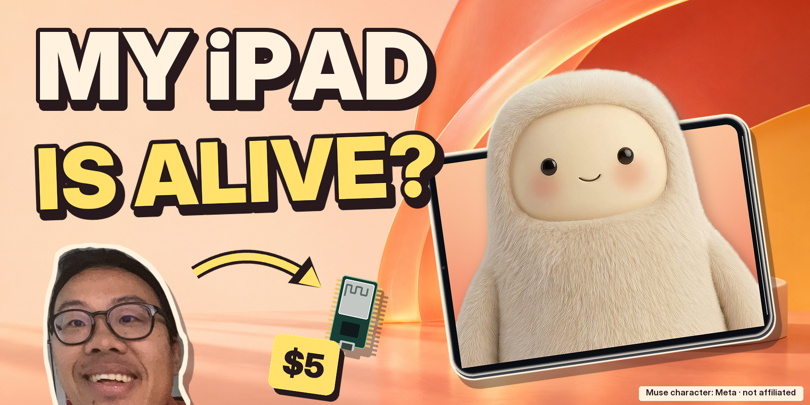
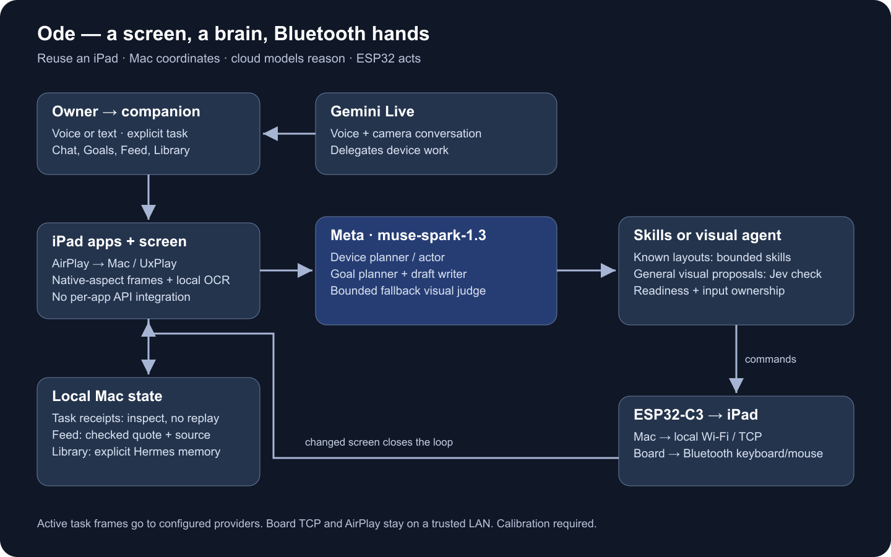

# Ode — Give Muse a Body

**Give Muse a body on the iPad you already own.**

**[Watch the 2:58 demo]([YOUTUBE_URL])** · [Two-minute judge guide](docs/JUDGES.md) · [Existing X result](https://x.com/hubeiqiao/status/2117654510482960846)

[]([YOUTUBE_URL])
<sub>Muse character: Meta · not affiliated with or endorsed by Meta. Thumbnail artwork: generated background, official Muse cutout, Joe's real face from the demo footage.</sub>

Ode lets an assistant **see, talk, tap and type** in real iPad apps without a per-app API integration. **Muse Spark makes screen-based app decisions; an ESP32 supplies Bluetooth keyboard and mouse input; a Mac coordinates the loop.** Gemini Live handles voice and camera conversation. Muse runs in the cloud. **No Xcode IDE required. No jailbreak.** About $5 covers the board only.

The intended first user is a builder or creator who already owns a Mac and a spare iPad: research in installed apps and bring back checked findings or a draft for owner review. The film demonstrates a photo-to-X skill and rednote research; repeat-run reliability and time saved remain to be measured.

**See the Meta-to-hardware proof at 01:30:** Muse Spark locates rednote’s search entry, then the ESP32 moves and taps. [Decision, HID acknowledgements and limits](docs/DEMO.md#sanitized-real-run-excerpt).

Built by **Joe Hu** for the [Meta Global AI Developer Hackathon](https://cerebralvalley.ai/e/meta-ai-developer-hackathon), Indie track · Push the Frontier.

Based on [ESP32 iPhone Agent](https://github.com/onehumanbeing/esp32-iphone-agent) by Henry Yuan.

[Two-minute judge guide](docs/JUDGES.md) · [Architecture](docs/ARCHITECTURE.md) · [Setup](docs/SETUP.md) · [Hardware](docs/HARDWARE.md) · [Safety](docs/SAFETY.md)

## Watch it work

**[Watch the 2:58 demo on YouTube]([YOUTUBE_URL])** · **[The real X post from the demo](https://x.com/hubeiqiao/status/2117654510482960846)**

| In the film | What to look for |
| --- | --- |
| **00:00 — Muse gets a body** | Muse leaps into the iPad (composite), then “Muse had no body.” |
| **00:10 — Meet Ode + Bluetooth hands** | Mac chat redrawn from the session recording; from 00:23.73, the ESP32 animation follows real HID commands. Camera opens around 00:27.6. |
| **00:29 — One continuous take: room → Psyduck → photo → X** | Gemini Live supplies scene conversation; the X photo skill uses owner-measured taps. Fresh “post it” confirmation precedes one send; the existing result appears at 01:15.70. |
| **01:17 — rednote, without an app API** | At **01:30.17**, a real Muse Spark screen decision leads to physical input. Spoken ingredients come from rednote's search-result AI summary, not the opened post body. |
| **01:50 — How it works** | Cloud model roles, Mac coordination, calibrated relative input and AirPlay feedback. |
| **02:07 — Skills, Goals, Feed and Library** | 24 app skill cards, bounded research and owner-controlled memory. These UI captures include saved state. |
| **02:24 — Live in Ottawa** | Shopify Builder Sundays, November 1: conversation with the room and an Amazon AirPods search (02:33.47). |

The home session was recorded November 3. The film compresses waits and marks speed changes; its hook is composited and its enlarged Mac chat is redrawn from the same session. [Exact chapters and editing disclosure](docs/DEMO.md). The post check returned uncertainty and Ode did not resend. The linked published result supplies evidence beyond a closed composer.

## How judges can verify it works

1. **Follow intent → action → result** in the camera sequence and open the existing X result. No new post is needed to judge it.
2. **Inspect the model-to-hardware connection.** The rednote run recorded this decision and the following real HID commands. This is a selected, sanitized excerpt from the recorded run, not a fresh execution:

   ```text
   Muse Spark / muse-spark-1.3 · locate public search entry
   target box: left=0.808 top=0.035 right=0.985 bottom=0.078
   confidence=0.95 · model time=4.287 s

   relative_s  command_id  HID command  write→ACK_s  accepted
   44.765      362         home         2.058        true
   46.824      363         move         0.301        true
   47.126      364         move         1.651        true
   49.380      365         move         0.215        true
   49.744      366         move         0.219        true
   50.976      367         click        0.132        true
   ```

   This landscape locate check routes directly to Muse Spark as the configured backup visual model. An ACK confirms board acceptance, not app success. Match the resulting tap to the screen in the film. These timings describe one step, not average latency.
3. **Inspect and reproduce the engineering.** This tree has **24 registered app skill cards**, **2,022 Python test definitions in 169 files**, and **14 JavaScript test files**. Those are static definitions, not execution results. [Testing commands, actual run totals and skip boundaries](docs/TESTING.md) · [Source and evidence map](docs/JUDGES.md).

## Meta AI at the center

| Model | Responsibility |
| --- | --- |
| **Meta `muse-spark-1.3`** via Meta Model API | Device planner/actor, Goal planner, source/draft writer and bounded fallback visual judge. Its screen decisions change what the physical iPad does. |
| **Jev `jev-latest`** | Primary visual proposal checks. The filmed landscape search locate uses the explicit Muse route described above. |
| **Gemini Live `gemini-3.8-live` in this setup** | Voice and camera conversation, including scene description; delegates device work to the coordinator. |

Muse runs in the cloud. Known skills, OCR and measured taps can execute bounded steps without asking Muse about every click. Wonder and local Glimmer are optional code paths, with no demo usage claimed. [Exact roles, flags and routing](docs/ARCHITECTURE.md#model-routing).

## A screen, a brain, Bluetooth hands



The Mac receives native-aspect AirPlay frames, applies local OCR/calibration and coordinates skills or the general visual agent. Checks and input ownership gate commands sent over local Wi-Fi/TCP to the ESP32-C3. Bluetooth HID operates the iPad; the changed screen closes the loop. [Architecture and source map](docs/ARCHITECTURE.md).

## More than individual commands

- **Camera → photo → X:** a calibrated photo/draft workflow with fresh confirmation before its guarded send. Actual account and published result still require inspection.
- **Research in rednote and other apps:** public search, visible source reading and short checked excerpts. A source check establishes what was observed, not whether every source claim is true.
- **Exploration → Feed:** Muse chooses a topic, visits a public source and saves a discovery only after a separate evidence check. The shown Baobab card comes from the November 3 Wikipedia visit.
- **Goals:** Muse chooses allowed public-research skills, checks a source and produces a **local draft for review**. Up to **eight skills / five minutes** per explicit session; no automatic restart.
- **Library and memory:** edit, forget or restore explicitly saved preferences. Selected Hermes MemoryStore components keep them on the Mac; conversation and task records are separate. Companion requests can include selected memory text. Meta Goal/exploration requests exclude personal Hermes memory.
- **24 app skill cards + a general visual agent:** known layouts have reusable capabilities; unfamiliar screens have a visual fallback. A card is not full app acceptance, and broader fallback reliability is still being evaluated.

## Companion on your phone

A mobile browser controls the Mac-hosted companion. These are actual companion captures of saved local state, not new device acceptance runs. Only the public-safe Library image is included.

<table>
  <tr>
    <td align="center"><br>Chat</td>
    <td align="center"><br>Goals</td>
  </tr>
  <tr>
    <td align="center"><br>Feed</td>
    <td align="center"><br>Library</td>
  </tr>
</table>

The orange Ode mascot is the project's own identity. Muse character: Meta · not affiliated with or endorsed by Meta.

## Hardware and quick start

**Review offline first:** [run the Python/Node suites](docs/TESTING.md), inspect the model/HID excerpt and read the source map. This needs no iPad, board or provider credentials.

**First physical checkpoint:** an attended “Open Settings,” after pairing, mirror and calibration checks. Follow the [acceptance ladder](docs/SETUP.md#first-run-acceptance-ladder); the filmed Camera/X skill additionally requires your own templates and OCR.

You need an **owner-controlled iPad, a Mac, an ESP32-C3 development board (~$5), a USB data cable, AirPlay, Bluetooth pairing and cloud API access**. USB powers/flashes the board; input reaches the iPad over Bluetooth. No GPIO wiring or iPad app installation is required. Mac command-line developer tools are needed for the receiver/local OCR.

**1. Install the server and offline text validator.** Python 3.12 and Node 22+ are the verification targets.

```sh
python3.12 -m venv .venv
. .venv/bin/activate
python -m pip install -e './server[dev,mcp]'
npm ci --prefix tools/twitter-text-validator
cp server/.env.example server/.env
```

Fill `META_API_KEY`, `TYPESAFE_API_KEY` and `GEMINI_LIVE_API_KEY` locally. Example files contain names only; never commit the filled file.

**2. Prepare hardware.** Follow [the board guide](docs/HARDWARE.md): identify the board, explicitly choose its serial port, back it up and verify that backup before writing. Build the firmware, pair **Ode iPad HID**, and [install UxPlay separately](docs/SETUP.md#airplay-receiver).

**3. Start the coordinating Mac.** Select your own display geometry; the numbers below are an iPad mini example.

```sh
export AGENT_ENGINE=meta_hybrid META_MODEL=muse-spark-1.3
export DEVICE_MODE=ipad AI_NAME=Ode AIRPLAY_NAME='Ode iPad'
export HOST=127.0.0.1 PORT=8890 DEVICE_PORT=7300 IDLE_NUDGE=0
export HIDAGENT_DATA="$PWD/runtime/ipad"
export UXPLAY="$PWD/scripts/uxplay-ipad.sh"
export UXPLAY_DISPLAY_SIZE=2266x1488 MIRROR_FRAME_HEIGHT=1080
./scripts/run-ode.sh
```

**4. Mirror and calibrate.** Mirror to **Ode iPad**, use landscape full-screen apps, then open [the companion](http://127.0.0.1:8890/companion) and [calibration UI](http://127.0.0.1:8890/). Confirm live frames, stable board connection and calibration before trying “Open Settings.”

The rebuilt companion is included. Goals need `APP_MISSIONS=1`; Meta Goal/draft roles use `META_MISSION_WRITER=1` and `META_DRAFT_WRITER=1`. Exploration needs `EXPLORATION_PUBLIC_BROWSER=1`. Enable only attended sessions after setup. Camera/photo fast paths need your own masked templates and local OCR; this checkout does not include personal captures or calibration. [Full setup](docs/SETUP.md) · [Build and offline verification](docs/TESTING.md).

## Safety and limits

- **$5 is the board, not the system.** The iPad, Mac, network and model APIs are additional requirements/costs.
- **Stay present.** Guarded photo sending needs fresh owner confirmation. Keep purchases, credential entry and sensitive settings human-operated. General visual prompts are not a universal action-authorization boundary.
- **Uncertainty stops automatic replay.** Inspect the real screen before reporting success. Stop tracks controller release; a disconnected board can leave release pending.
- **Cloud processing is part of the design.** Task frames/instructions go to configured Meta/Jev providers; explicitly started voice sessions send audio and live vision to Gemini. Local storage does not imply local inference. Stop sessions and keep private notifications out of view.
- **Coverage is bounded.** App updates, moving feeds, hidden pointers and calibration affect results. Several fast paths target a measured 1646×1080 layout. General fallback, other layouts, native-source Feed rendering and current voice continuity need broader live evaluation.

Default HTTP access is loopback. Optional remote control uses an exact HTTPS origin and verified Cloudflare Access JWT or strong owner token; board TCP/AirPlay remain on a trusted LAN. [Safety and data flow](docs/SAFETY.md) · [Remote access](docs/DEPLOY-CLOUDFLARE.md).

## Roadmap

1. Measure consecutive-run completion, uncertainty and latency on repeatable everyday tasks.
2. Guide board pairing, portable calibration and privacy-safe template creation.
3. Expand app/layout acceptance and general visual recovery without repeated input.
4. Improve voice continuity and source display, including native-app discoveries without web URLs.

## Credits

Based on [ESP32 iPhone Agent](https://github.com/onehumanbeing/esp32-iphone-agent) by Henry Yuan. The original **Copyright (c) 2026 Henry Yuan**, [MIT LICENSE](LICENSE) and [NOTICE](NOTICE) remain, alongside the Ode contributors' copyright. Public demos, videos and posts of this derived work should credit Henry's project too.

**Memory store:** [Hermes Agent](https://github.com/NousResearch/hermes-agent) by Nous Research (MIT). Selected MemoryStore components are vendored, not the whole agent; [pinned provenance](server/hidagent/hermes_memory/UPSTREAM.md).

**Muse character: Meta · not affiliated with or endorsed by Meta.** The cover uses a character cutout from Meta's launch film over a real desk shot; attribution does not grant additional reuse rights. The orange Ode mascot is separate project artwork. [Asset credits](docs/assets/README.md).

UxPlay is an external GPLv3 receiver and is not bundled. Jev provides visual checks and Gemini Live supplies conversation. [Other dependency notices](docs/DEPENDENCIES.md) · [Contributing](CONTRIBUTING.md).
