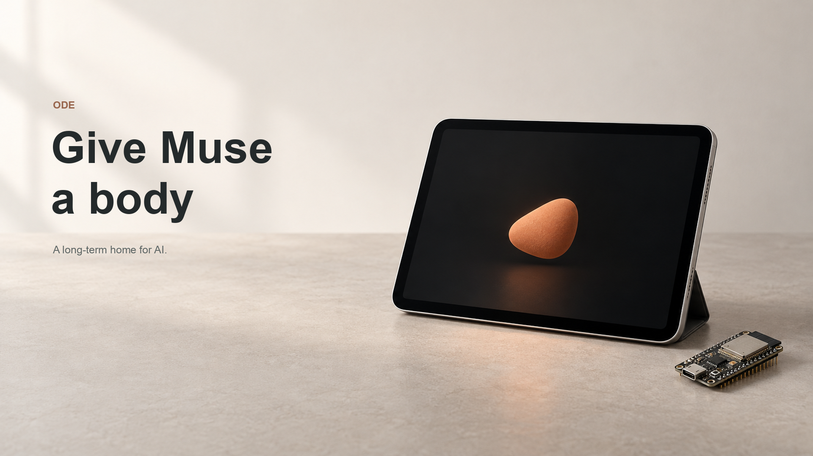

# Ode — Give Muse a body

**Muse lives on your idle device, operates it for you, and can watch you and chat with you while it works.**

An idle iPad becomes Meta Muse's own body: **Muse Spark sees and plans; a ~$5 ESP32 gives it Bluetooth keyboard and mouse hands.** Works with apps that have no API. No jailbreak, no Xcode, no app APIs.

[](LICENSE) 



**[Demo video — recording/link pending](docs/DEMO.md)** · [Architecture](docs/ARCHITECTURE.md) · [Hardware](docs/HARDWARE.md) · [Remote access](docs/DEPLOY-CLOUDFLARE.md)

Built for the **[Meta Global AI Developer Hackathon](https://cerebralvalley.ai/e/meta-ai-developer-hackathon)**, indie developer track, *Push the Frontier*: give a machine a new capability in the real world.

Based on [ESP32 iPhone Agent](https://github.com/onehumanbeing/esp32-iphone-agent) by Henry Yuan.

## What it does

Talk to Ode live. It watches the mirrored iPad screen throughout an active voice session, delegates device work to Muse Spark, and reports what happened. Camera conversation lets it see you through the iPad's Camera app. Known apps get fast skills; unfamiliar apps use the general visual agent. **Any app is the design goal, not a claim of universal tested compatibility.**

The submission story has three segments:

| You ask | Ode does |
| --- | --- |
| “Open the camera. Take a photo. Prepare a post on X.” | Opens Camera, takes a picture, prepares the photo and caption, reads the draft back, and waits for explicit owner confirmation before sending. |
| “Search rednote for shrimp recipes. Open a post and tell me what it says.” | Searches the real app, opens a result, reads it, and reports the source. |
| “Explore something surprising and bring back one discovery with a source.” | Chooses a direction, navigates visually, and checks a discovery against source content before reporting it. |

**Evidence boundary:** these are the approved recording scenarios. This public snapshot has offline regression coverage; final video and end-to-end device revalidation are pending. Device-specific captures and calibrated templates are intentionally excluded. See [demo acceptance](docs/DEMO.md).

## How it works


1. **Eyes:** AirPlay mirrors the iPad at its native aspect/resolution; the Mac captures frames and runs optional local OCR.
2. **Brain:** Muse Spark plans and selects actions. Jev checks visual proposals; Muse Spark is the fallback visual judge.
3. **Hands:** the Mac sends commands over local TCP to an ESP32-C3. BLE HID moves the pointer, clicks, types and presses shortcuts on the iPad.
4. **Voice:** Gemini Live handles the live conversation and vision for that voice session. Device planning and execution stay with Muse Spark.
5. **Feedback:** skills accelerate known layouts; the general agent handles other screens. Receipts, screen checks and completion feedback keep the conversation grounded.

## Technical highlights

- **Native-resolution landscape mirroring:** advertise the iPad display geometry instead of a generic 16:9 surface, then calibrate against the actual processing frame.
- **Calibrated pointer control:** observed-pointer correction plus a freshly re-homed fallback for apps that hide the pointer.
- **Local icon and picker detection:** geometry-bound templates and OCR reduce model calls; unknown layouts fail closed or take the visual route.
- **One ongoing voice conversation:** live screen vision, task interjections, stop requests and completion feedback while Muse works. Camera mode can reconnect the underlying Live session.
- **Explicit action boundaries:** guarded publishing flows require fresh owner words. Login, purchase and sensitive-setting requests must stop for the owner; see [safety limits](docs/SAFETY.md).

## Meta models used

| Model | Role in the documented configuration |
| --- | --- |
| **`muse-spark-1.3`**, Meta Model API (`https://api.meta.ai/v1`) | Planner/actor, general visual reasoning, companion text, source writing, optional mission/draft writing, and fallback visual judge in `AGENT_ENGINE=meta_hybrid`. |

The client also supports optional **`muse-wonder-1.0`** (including an explicitly selected reasoner role) and a local Meta-compatible model path, whose default identifier is **`muse-glimmer:30b`**. Neither is selected by this quick start. They are code-supported options, not claimed demo usage. No Meta image generator or SAM model is used. Jev (`jev-latest`) is the primary judge; **Gemini Live (`gemini-3.8-live`) is only the voice/conversation layer**, including its live vision. [Exact routing](docs/ARCHITECTURE.md#model-routing).

## Hardware

An **iPad** with AirPlay and Bluetooth HID support, a **~$5 ESP32-C3 development board**, a data USB cable, and a **Mac**. USB powers/flashes the board; the iPad receives input over Bluetooth. No electrical connection to the iPad is needed. Board prices vary; iPad/Mac and API usage are additional costs. [Build and flashing guide](docs/HARDWARE.md).

## Quick start

Use Python 3.12, Node 22+, and a Mac with UxPlay and its GStreamer plugins installed. Start from this repository's root directory; no public clone URL is assumed until the owner chooses it.

**1. Install the local server and offline text validator.**

```sh
python3.12 -m venv .venv
. .venv/bin/activate
python -m pip install -e './server[dev,mcp]'
npm ci --prefix tools/twitter-text-validator
cp server/.env.example server/.env
```

Edit `server/.env` locally: set `META_API_KEY`, `TYPESAFE_API_KEY`, and `GEMINI_LIVE_API_KEY`. The template contains names and comments only. Never commit the filled file.

**2. Prepare the board and receiver.** Follow [HARDWARE.md](docs/HARDWARE.md): install the ESP32/NimBLE dependencies, back up the explicitly chosen board, build the BLE firmware, pair **Ode iPad HID**, and enable the iPad's pointer support. Install [UxPlay separately](docs/SETUP.md#airplay-receiver); it is not bundled.

**3. Start Ode.** This sets the Muse Spark profile explicitly; `.env` supplies only your private credentials and optional overrides.

```sh
export AGENT_ENGINE=meta_hybrid META_MODEL=muse-spark-1.3
export DEVICE_MODE=ipad AI_NAME=Ode AIRPLAY_NAME='Ode iPad'
export HOST=127.0.0.1 PORT=8890 DEVICE_PORT=7300 IDLE_NUDGE=0
export HIDAGENT_DATA="$PWD/runtime/ipad"
export UXPLAY="$PWD/scripts/uxplay-ipad.sh"
# Set these to YOUR iPad's native display dimensions, in landscape:
export UXPLAY_DISPLAY_SIZE=2266x1488 MIRROR_FRAME_HEIGHT=1080
./scripts/run-ode.sh
```

**4. Mirror and calibrate.** On iPad, select **Ode iPad** in Screen Mirroring and use landscape full-screen apps. Open [the companion](http://127.0.0.1:8890/companion) and [the control/calibration UI](http://127.0.0.1:8890/). Confirm live frames, board readiness, the selected iPad profile, and calibration before a device task. Recalibrate whenever geometry or pointer settings change.

**5. Start with “Open Settings.”** Enable the microphone for live voice. For camera/photo skills, configure your own masked UI templates and `LOCAL_OCR_BIN`, then set `IPAD_VOICE_DEMOS=1` and `CAMERA_CONVERSATION=1` only after [the local checks](docs/SETUP.md#camera-and-photo-skills). An unconfigured public checkout cannot reproduce the filmed setup automatically.

The built companion is included. To rebuild it and run the complete offline suite:

```sh
npm ci --prefix companion-ui
npm run build --prefix companion-ui
cp -R companion-ui/dist/. server/hidagent/static/companion/
(cd server && PYTHONPATH=. ../.venv/bin/python -m pytest -q -p no:cacheprovider)
node --test server/tests/*.test.mjs server/tests/*.test.cjs
```

## Safety & privacy

Use an owner-controlled device and an attended session. Ode must never post, buy or log in without explicit owner words; the guarded demo requires a fresh confirmation before publishing. General visual control remains a research prototype, so model instructions are not a universal authorization guarantee. Keep purchases and credential entry human-operated. A tool receipt is not visible success: inspect the device, and never resend an uncertain action.

AirPlay/ESP32 traffic stays local, but active task screenshots and instructions go to the configured model providers; live audio and vision go to Gemini Live. Camera-preview frames are blocked from Meta task-model calls during camera sessions. There are no idle model uploads by design; turn off sessions when finished. Local memory, calibration and optional traces stay on the Mac and out of Git. [Data flow and controls](docs/SAFETY.md).

The web server binds to loopback by default. Optional remote access requires Cloudflare Access JWT verification or a strong owner token **and** an exact configured HTTPS origin. Forwarded traffic is never trusted just because the tunnel connects from localhost. [Tunnel setup](docs/DEPLOY-CLOUDFLARE.md).

## Limitations / roadmap

This is a hardware research prototype. Wi-Fi latency, moving feeds, hidden pointers, app updates, OCR and model errors affect reliability. Several fast paths target a calibrated **1646×1080** processing frame; other layouts need new validation. Camera templates and all personal app captures are excluded. Any-app compatibility and uninterrupted operation are not guaranteed. Offline tests do not establish live API availability, physical timing or device success.

Next: portable calibration, a guided template setup, broader app/layout coverage, recovery without repeated input, and measured live acceptance across more devices. Optional native/iPhone experiments are isolated under [legacy/](legacy/README.md); they are not needed for the submission.

## Credits

Ode builds on **ESP32 iPhone Agent / Handsy AI by Henry Yuan**. The original MIT copyright and [NOTICE](NOTICE) are retained, with an additional copyright for Ode contributors. Public demos, videos and posts of this derived work should also credit Henry's project.

Muse Spark powers the device reasoning. Jev provides proposal checks. Gemini Live supplies voice conversation. UxPlay is an external GPLv3 receiver; no UxPlay source or executable is redistributed here. Other retained components and licenses are listed in [DEPENDENCIES.md](docs/DEPENDENCIES.md). The cover and Ode avatar are illustrative artwork, not evidence of a live run. [Contributing](CONTRIBUTING.md).
