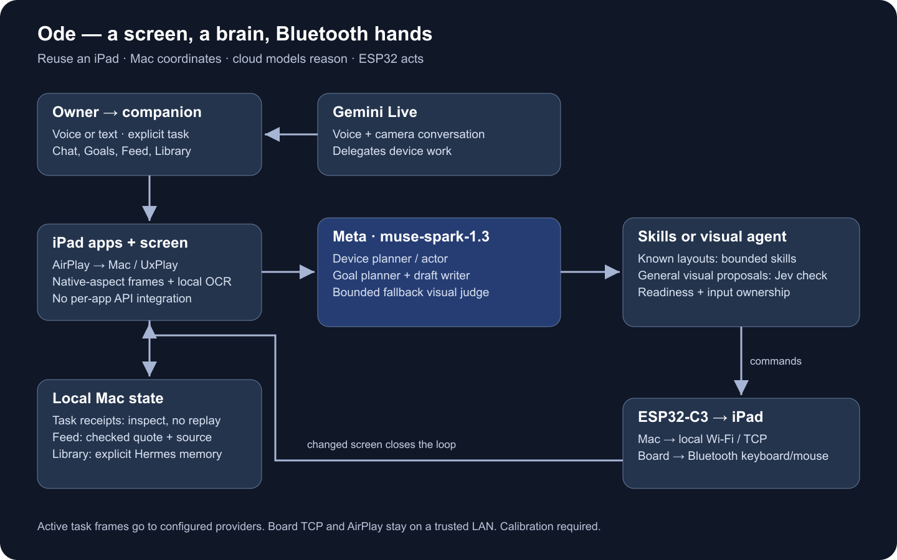

# Architecture

[Documentation](README.md) · [Project](../README.md)

Muse lives on an idle iPad, talks to its owner, and operates the device through physical Bluetooth input. The Mac hosts the model clients, screen receiver, orchestration and local state. The iPad needs no agent app or jailbreak.

## Perception → decision → input → verification

`Screen` (`server/hidagent/screen.py`) runs an external UxPlay process or follows a separately managed receiver. UxPlay receives AirPlay; GStreamer emits frames. `UXPLAY_DISPLAY_SIZE` advertises the native landscape dimensions, avoiding an external-screen layout caused by generic 16:9 negotiation. `MIRROR_FRAME_HEIGHT` sets processing-frame height while preserving aspect. Calibration binds input to the resulting geometry, not to an assumed display size.

`HybridAgent` combines structured keyboard/navigation skills and visual proposals. Meta's client in `meta_model.py` provides planning/acting; `decision.py` supplies the primary Jev visual judge, with `VisionJudge` as a fallback. Not every HID packet triggers a model call: locally checked skills execute bounded sequences. Unfamiliar screens enter the general visual path.

`Phone` converts intended screen points into calibrated HID motion. Visible-pointer measurements can correct movement. If an app hides the mirrored pointer, the calibrated re-home path starts from a known corner and verifies subsequent state. Calibration, geometry, stability and ownership checks still apply; hidden-pointer handling does not establish universal click accuracy.

`Device` sends commands over a local TCP connection to the ESP32-C3. `hid_bridge_ble_c3.ino` emits BLE keyboard/mouse reports. The iPad sees ordinary paired input hardware. The Mac's board TCP listener and AirPlay stay on a trusted local network; the public HTTPS tunnel never exposes their ports.

`AppTools`, `DriverExecutor` and `hid_lease` coordinate ownership, cancellation and task receipts. An uncertain receipt must not be resent. A model's “done” is not proof of a visible result. Guarded photo publishing binds one-use confirmation to the pending task and checks attachment/nonempty caption. The owner must inspect account and exact caption; a closed composer alone is not independent publication proof.

## Live conversation and camera

`live_voice.py` mints short-lived Gemini Live credentials with the long-lived key on the Mac. The companion uses the live audio connection and streams the mirrored screen during an active normal voice session. The server still owns device actions; Gemini delegates them through bounded tools to the Muse-backed executor. Completion feedback and owner interjections keep the spoken conversation associated with the current task.

Camera conversation operates the iPad Camera app and uses its mirrored preview for live conversation vision. `frame_privacy.py` blocks camera-preview frames from Meta task-model calls while camera scope is active. Switching camera/normal modes can reconnect the underlying Live transport; “one conversation” does not mean one permanently uninterrupted WebSocket. No unattended background camera service is claimed.

Local icon/picker matching and Camera controls depend on layout-bound masked templates. Those captures are not public assets. Without an operator-configured `CAMERA_TEMPLATE_DIR`, `X_PHOTO_TEMPLATE_DIR`, `APP_CONTROLS_DIR` or `APP_ICON_LAYOUT`, the corresponding local matchers cannot claim a hit. They either use their existing visual route or refuse an unsupported layout. See [SETUP.md](SETUP.md).

## Model routing

| Selection | Exact code behavior |
| --- | --- |
| `AGENT_ENGINE=meta_hybrid`, `META_MODEL=muse-spark-1.3` | `meta_llm()` supplies `HybridAgent`'s model client and the backup `VisionJudge`; Meta endpoint is fixed to `https://api.meta.ai/v1`. The companion uses `agent.actor`. |
| Primary proposal judge | `Jev.from_env()`: `JEV_MODEL` defaults to `jev-latest`, credentials from `TYPESAFE_API_KEY` or explicitly supplied `JEV_KEY_FILE`. |
| Optional mission/draft writer | `META_MISSION_WRITER=1` / `META_DRAFT_WRITER=1` select hosted Meta clients with `mission` / `draft` roles. `META_MISSION_MODEL` / `META_DRAFT_MODEL` otherwise inherit `META_MODEL`. The base quick start leaves these off; enable both explicitly for Meta-backed Goals. |
| Optional hosted role | `meta_llm(role='reasoner')` defaults to `muse-wonder-1.0`; the hosted client accepts `muse-spark-1.3` and `muse-wonder-1.0`. This is supported code, not an assertion of demo use. |
| Optional local engine | `meta_local_hybrid` accepts a numeric loopback `/v1` endpoint; its default local model name is `muse-glimmer:30b`. No local weights are bundled or validated here. |
| Voice | `live_voice.MODEL` is `gemini-3.8-live`. It handles conversation, transcription/tool delegation and live vision, not the Muse device-planning role. |

The standalone generic `Agent` has separate actor/planner clients. The submission selects `HybridAgent`, which uses its configured Meta client across planning/acting rather than a separate hosted planner service. Dedicated Meta credentials never fall back to another provider's key. Model access and availability depend on the operator's accounts; this release preparation made no model calls.

## Trust boundaries and remote access

`access.py` gates every HTTP and WebSocket route, including frames, static assets and task state. Local access requires a loopback peer and loopback Host with no forwarding headers. Forwarded or non-local access requires an exact `ODE_PUBLIC_ORIGIN` and either a cryptographically verified Cloudflare Access JWT or an owner bearer token. Remote authorization is stored only in the ASGI scope so route-local checks can recognize a verified request.

The JWT verifier pins RS256, the configured issuer and audience, and required expiry/issued-at/subject claims. Public signing keys are fetched from the configured Cloudflare team's fixed cert endpoint with a timeout. Unverified headers never authorize a request. Wrong origins and cross-site fetches are rejected. Forwarded headers do not rewrite transport identity in the supplied server entrypoint.

Action authorization remains separate from HTTP access. Owning an authenticated browser does not authorize an arbitrary public post or purchase. Screen text, search results and app cards are untrusted task data.

## Source map

| Area | Responsibility |
| --- | --- |
| `server/hidagent/` | FastAPI, model clients, screen/board I/O, skills, voice, safety and local state |
| `companion-ui/` | React/Vite companion source, lockfile and dependency notices |
| `server/hidagent/static/companion/` | Rebuilt distributable served without a Node runtime |
| `devices/ipad/firmware/hid_bridge_ble_c3/` | BLE HID firmware and empty secrets template |
| `scripts/uxplay-ipad.sh`, `tools/native-probe/vision_ocr.swift` | External receiver wrapper and optional local OCR worker |
| `server/tests/` | Offline protocol, geometry, control, voice and safety tests |
| `legacy/` | Isolated upstream/native compatibility material; outside the submission path |

No per-app API is required for device operation. The optional public-browser exploration helper is off by default; the iPad visual path remains the submission's interaction mechanism.

## Goals, discoveries and local memory

`app_mission.py` lets Muse choose allowed public-research skills within eight skills/five minutes, checks a source and returns a local review draft. `app_tools.py` binds checked excerpts to the current completed result; old saved receipts cannot silently become a fresh source. `exploration_agent.py` separates proposed topics from observed findings and a separate visual evidence check. Only completed evidence is persisted into the Feed.

The companion's Library exposes edit/forget/restore for explicitly saved Hermes MemoryStore preferences on the Mac. Recent conversation and durable task records are separate. Companion cloud requests may include selected memory; Meta Goal/exploration clients exclude personal Hermes preferences/discoveries. The public source includes storage implementation and synthetic fixtures, never an operator's stores.

## Latest source integration and limits

This release exports the pinned source `f3e3317c04a9dc0c4cc4e9beb04dd6ecc2e00cd2`, with the previous public export's sanitization and omitted private assets retained. The current voice path sends low-resolution in-memory frames, joins repeated pending Camera calls, and coordinates co-issued stop/new-action calls. A 1.5-second suppression heuristic can ignore a stop arriving with a new action; the eight-second post-stop resume window also needs live evaluation. Screen freshness and transport continuity are not established by offline checks alone.

The hybrid actor waits on changed scenes, then permits non-typing actions after a bounded moving-screen streak so autoplaying feeds do not stall forever. Typing and Enter continue to wait for stillness. This trades prolonged waiting against stale-target risk; inspect outcomes. Search/open skills recover Home before launching to avoid stale sheets/modals.

Camera scope blocks preview frames to Meta task models while active. Outside it, recognized Camera UI is allowed by default unless optional refusal is selected. Active Gemini voice vision can include the mirrored screen/preview. No universal privacy filtering is claimed. Native-app discovery records can lack a web URL; the current Feed renderer needs broader acceptance for that case.
