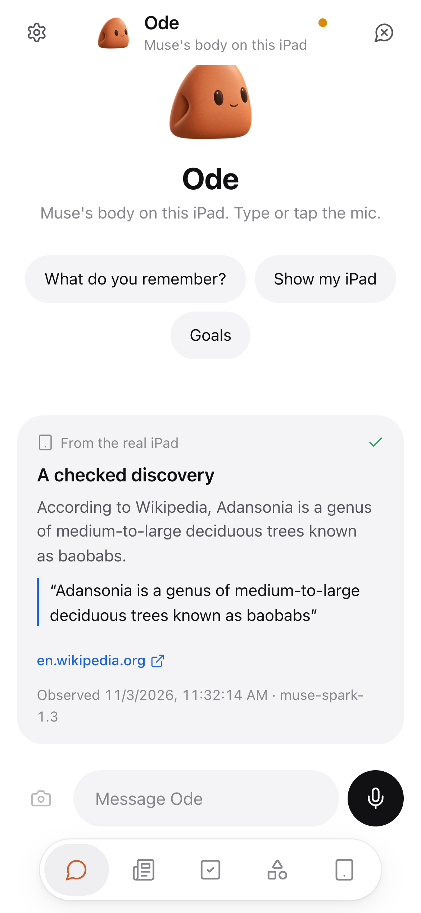
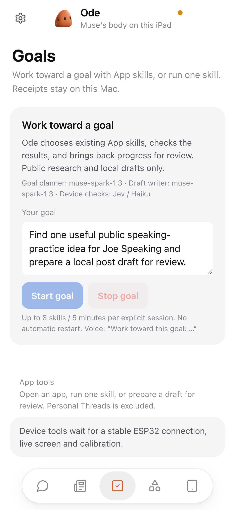
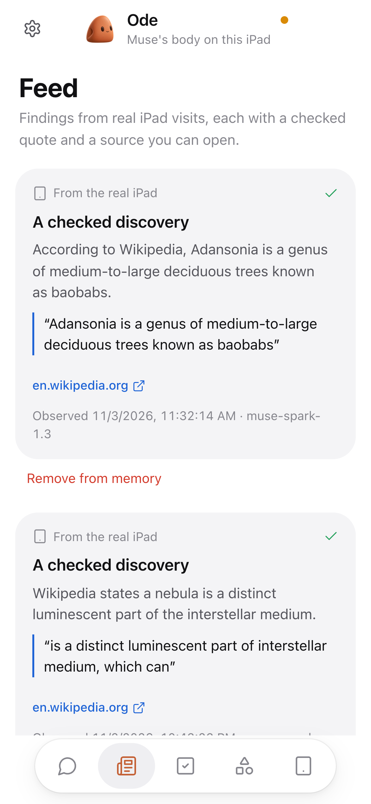
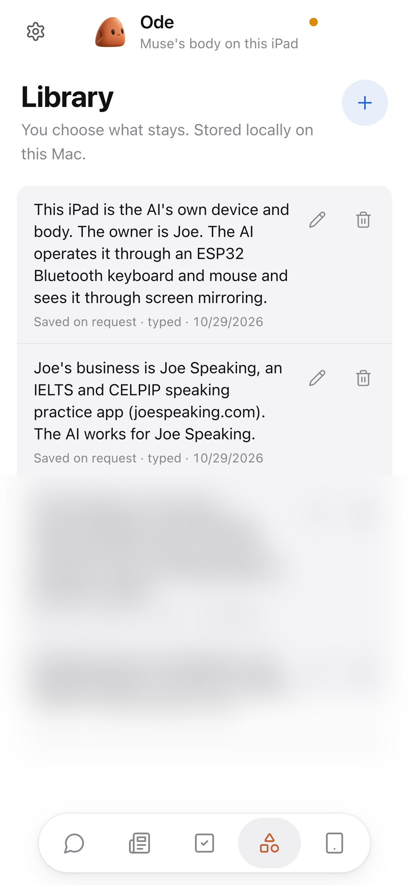

# Demo: intent, physical action, visible result

[Watch the 2:58 v6 film](https://youtu.be/0wcoqi5CVuQ) · [Existing home-demo X post](https://x.com/hubeiqiao/status/2117654510482960846) · [Judge guide](JUDGES.md)

The home footage was recorded November 3, 2026. Stage footage is from Shopify Builder Sundays, Ottawa, November 1. These positions follow **VIDEO-METADATA-v6.md, updated November 4 for the 00:24 render**: 5,359 frames at 30 fps, **2:58.63**. They are film positions, not task latency measurements.

## Chapters for the final v6 cut

Keep these seven chapter starts aligned with the accepted video description. The ESP32 explainer shares the Meet Ode chapter; the end card shares the stage chapter. Meet Ode's exact start is 00:09.70; its chapter rounds to 00:10 so the opening chapter is at least ten seconds.

```text
00:00 Muse leaps into my spare iPad · “Muse had no body.”
00:10 Meet Ode (the Mac app, the real conversation) · a $5 ESP32 gives Muse hands
00:29 One continuous take: it describes what it sees, takes a photo and posts it on X
01:17 Even apps with no API: rednote, one real Muse Spark step
01:50 How it works
02:07 Skills, Goals, Feed and Library
02:24 Live on stage at Shopify Builder Sundays, Ottawa (incl. an Amazon AirPods search)
```

## Exact scene and evidence positions

| Film time | Scene / evidence |
| --- | --- |
| 00:00.00 | Muse leaps into an idle iPad. This character/desk composite is the hook, not device execution; there is no Camera-open shot here. |
| 00:02.87 | “Muse had no body.” → “Now it lives on my spare iPad.” → Ode title and hackathon credit. |
| 00:09.70 | Meet Ode: self-introduction with enlarged Mac chat redrawn from the session's words in their original order. |
| 00:23.73 | ESP32 “gives Muse hands” explanation; board-command animation is timed to real HID logs. The real board taps Camera around 00:27.6 and Camera opens. |
| 00:29.30 | One continuous source take: describe the room → Psyduck → photo → X compose → fresh “post it” confirmation → one send. The source session runs from self-introduction through the post; the delivered film compresses time. Room-description request is at 00:30.63; Psyduck enters around 00:38.57. Gemini Live supplies room/Psyduck conversation; the Camera/X sequence uses a measured-tap skill. |
| 01:15.70 | Linked result card for the actual [X post](https://x.com/hubeiqiao/status/2117654510482960846). The automated check returned uncertainty; no resend was made. |
| 01:17.40 | rednote search and reading. The ingredients reported aloud came from its search-result AI summary, not the opened post body. |
| 01:30.17 | Real Muse Spark search-entry decision (narration begins 01:28.97). Bounding box/confidence and subsequent input are excerpted below. |
| 01:50.00 | Architecture: voice, Meta device reasoning, board input and mirrored-screen feedback. |
| 02:07.13 | 24 skill cards, bounded Goals, Feed and Library. These include companion captures of saved local state; a UI overview is not a fresh Goal execution. The Baobab Feed card is from the same November 3 run at 11:32. |
| 02:24.27 | Live stage excerpt; Amazon AirPods search appears at 02:33.47. Gemini Live supplies the room conversation. |
| 02:51.70 | End card and credits. |

## What is edited for time and readability

The film cuts waits, speeds footage up in places and marks speeds on screen. It combines the home camera/post run, a later rednote run, companion saved-state views and the November 1 stage footage. It is not a 2:58 end-to-end latency claim. The hook leap is composited; the enlarged Mac chat is a faithful redraw. Narration is AI voice, and overlays/architecture explain the recorded workflow. App screens and physical device footage after the hook are real. The camera/photo/X path is a measured-tap skill, not proof that the general visual fallback completed that entire sequence.

Muse character: Meta · not affiliated with or endorsed by Meta. Based on [ESP32 iPhone Agent](https://github.com/onehumanbeing/esp32-iphone-agent) by Henry Yuan (MIT). Memory store: [Hermes Agent](https://github.com/NousResearch/hermes-agent), Nous Research (MIT).

## Sanitized real run excerpt

The film production's source-aligned extraction of the November 3 input timeline and model-step records contains the following fields. Only this short whitelisted excerpt is distributed. Original traces, screen files, absolute paths, connection/device identities and conversations are excluded. `relative_s` is seconds within the rednote source clip, not the edited film. `write→ACK_s` measures command write to board acknowledgement, including motion completion; it is not total task time.

```text
muse-spark-1.3 · purpose: locate public search entry
model_seconds=4.287 · confidence=0.95
box={left:0.808, top:0.035, right:0.985, bottom:0.078}
routing: opt-in landscape locate directly to backup visual model

relative_s  command_id  command  write→ACK_s  accepted
44.765      362         home     2.058        true
46.824      363         move     0.301        true
47.126      364         move     1.651        true
49.380      365         move     0.215        true
49.744      366         move     0.219        true
50.976      367         click    0.132        true
```

A board ACK establishes acceptance by the board. The changed screen in the film establishes the visual effect. A model's confidence is its own score, not a calibrated correctness rate. This single step cannot establish average latency, arbitrary-app compatibility or system-wide reliability.

## How to evaluate without replaying publication

Inspect the existing video/result and read the implementation/tests in [JUDGES.md](JUDGES.md). No device actions were run to prepare this release. Reproduction requires the owner's board pairing, API access, calibration and local masked templates. Start with read-only navigation. Do not replay the historical X send or infer new authorization from the recorded confirmation.

The photo flow's terminal label can mean the composer closed. It alone does not independently verify server-side publication, actual account or exact caption equality. The film and supplied existing post are the result evidence. No engagement totals, measured productivity benefit or broad app benchmark is claimed. The release check could not independently fetch X through its web fetcher; the link is the owner's supplied published result.

## Companion and capability boundaries

The mobile browser controls the Mac-hosted companion. These selected captures show saved local state, not a newly executed device acceptance run. Only the public-safe Library image is included.

<table>
<tr><td align="center"><br>Chat</td><td align="center"><br>Goals</td></tr>
<tr><td align="center"><br>Feed</td><td align="center"><br>Library</td></tr>
</table>

- **Camera → photo → X:** calibrated preparation and a guarded send with fresh confirmation. The operator checks the actual account, exact caption and photo. See the [judge guide’s photo readback-gate limitation](JUDGES.md#evidence-boundaries-worth-checking).
- **Public app research:** visible source reading and checked excerpts. A source check establishes what was observed, not whether every source claim is true. The filmed rednote ingredients came from the search-result AI summary rather than the opened post body.
- **Exploration → Feed:** Muse chooses a topic, visits a public source and saves a discovery only after a separate evidence check. The shown Baobab card comes from the November 3 Wikipedia visit.
- **Goals:** Muse selects allowed public-research skills, checks a source and produces a local review draft. Each explicit session is bounded to eight skills / five minutes, with no automatic restart.
- **Library and memory:** edit, forget or restore explicitly saved preferences. Selected Hermes MemoryStore components keep them on the Mac; conversation and task records are separate. Companion requests can include selected memory text. Meta Goal/exploration requests exclude personal Hermes memory. Local storage is separate from cloud inference.
- **24 app skill cards + a general visual agent:** known layouts have reusable capabilities, with visual fallback for unfamiliar screens. A registered card is not full app acceptance; broader fallback reliability remains to be evaluated.

The orange Ode mascot is project artwork. Muse character: Meta · not affiliated with or endorsed by Meta. [Media provenance and excerpt speeds](assets/media/README.md) · [Safety](SAFETY.md).
